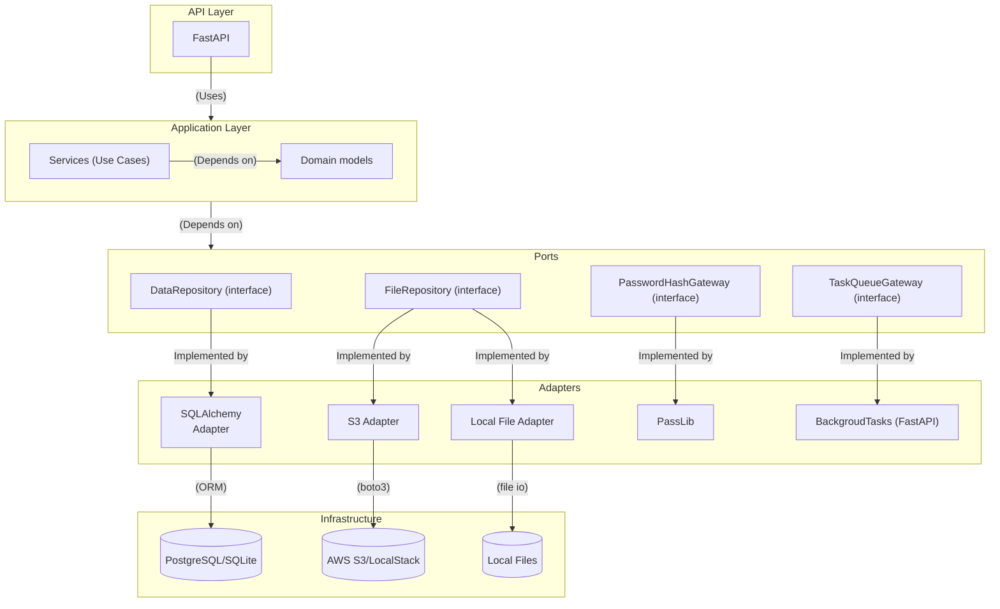
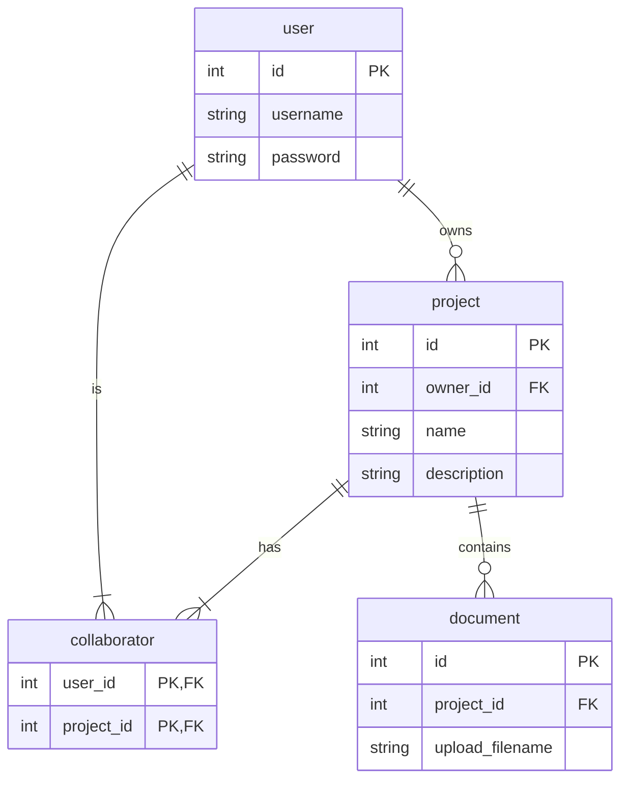

# FastAPI Project Board

[](https://github.com/mmjakub/fastapi-proj-board/actions/workflows/ci.yml)
[](https://github.com/mmjakub/fastapi-proj-board/actions/workflows/docker-image.yml)

---

## 🚀 Overview

**FastAPI Project Board** is a backend service for project management and collaboration, built with a strong emphasis on clean architecture, testing, and modern DevOps practices. This application is an educational project exploring Python, concurrency, FastAPI, SQLAlchemy, AWS S3, Docker, CI/CD, and software engineering best practices.

---

## 🏗️ Architecture

### Component & Interface Diagram



### Database ER Diagram



---

## 🧑‍💻 Technologies

- **Frameworks**: FastAPI, SQLAlchemy (async), Pydantic
- **Databases**: PostgreSQL, SQLite (for tests)
- **Cloud & Storage**: AWS S3 (via boto3), LocalStack (for local S3 testing)
- **Authentication**: JWT (with `joserfc`), OAuth2 password flow
- **DevOps**: Docker, Docker Compose, GitHub Actions CI/CD, AWS ECR
- **Testing**: pytest, moto (S3 mocking), FastAPI TestClient
- **Documentation**: OpenAPI (auto-generated), Mermaid diagrams

---

## 🧩 Features

- **User Authentication**: Secure JWT/OAuth2 login/register endpoints
- **Project Management**: Create, update, delete, list projects
- **Access Control**: Owner/collaborator roles, JWT-protected endpoints
- **Document Management**: Upload, download, update, delete files (S3/local)
- **Project Sharing**: Add collaborators via invite endpoint
- **Error Handling**: Custom exception classes, unified API error responses

---

## 🧪 Testing Strategy

### Unit Tests

- **Core Business Logic**: Pure service layer tested with mocks, fakes, and test doubles for complete coverage.
- **Classical/London styles**: Demonstrates both testing schools and their trade-offs.

### Integration Tests

- **Database Integration**: SQLAlchemy and SQLite in-memory for full CRUD and relationship checks.
- **API Endpoints**: FastAPI TestClient drives tests for all endpoint flows.
- **File Storage**: moto-powered S3 mocking and local file system checks.

---

## 🔁 CI/CD Pipeline

### GitHub Actions

- **ci.yml**: Lints with `flake8` and runs `pytest` on every push/PR.
- **docker-image.yml**: Builds and pushes Docker image to AWS ECR on release.

### Docker & Compose

- **Dockerfile**: Minimal production-ready image.
- **docker-compose.yaml**: Local dev stack with PostgreSQL, LocalStack (for S3), and app service. Health checks ensure reliable startup.

---

## 📋 API Documentation

- **OpenAPI/Swagger**: Available at `/docs` when running the app.
- **Sample Endpoints**:
    - `POST /register`, `POST /login`
    - `POST /projects`, `GET /projects`, `PUT /projects/{id}/info`
    - `POST /projects/{id}/invite?user=...`
    - `POST /projects/{id}/documents`, `GET /documents/{id}`, etc.

---

## 💡 Explored Concepts

- **Modern Python API design**: FastAPI, async, type-safe, dependency injection
- **Hexagonal/Ports & Adapters architecture**
- **Testing excellence**: Test pyramid, test doubles, and separation of concerns
- **DevOps & CI/CD**: Docker, Compose, GitHub Actions, cloud registry automation
- **Cloud-native development**: AWS S3, ECR, ready for ECS deployment

---

## 🏁 Running Locally

```sh
# 1. Clone and configure environment
git clone https://github.com/mmjakub/fastapi-proj-board.git
cd fastapi-proj-board

# 2. Start stack (requires Docker, Compose)
docker compose up --build
```

---

## 📎 References

- [docs/spec.md](docs/spec.md): Project requirements & API spec
- [docs/db.md](docs/db.md): Database ER diagram (Mermaid)
- [docs/openapi.json](docs/openapi.json): OpenAPI schema

